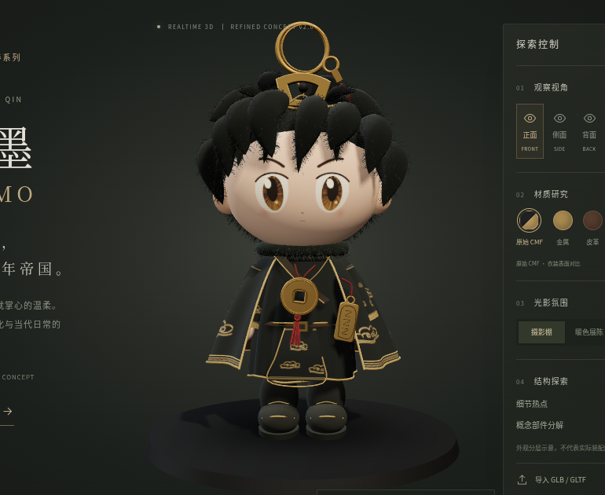
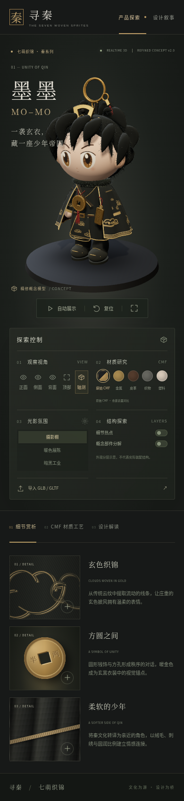

# 墨墨 V2 模型精修验收

本次范围是改善现有概念模型的外观质量，保留所有第一版镜头、热点、材质研究、灯光、分解及 GLB/GLTF 导入能力。

## 对照重点

1. **正面**：头脸比例、渐细刘海、深棕眼睛与眉形、黑金叠襟衣装、方孔钱与红色流苏。
2. **侧面**：脸部曲面、耳部、发束体积、披风厚度与手部关系，检查穿插和贴图接缝。
3. **背面**：发型覆盖、披风褶皱、云纹分布和包边；背部形态仍是概念设计。
4. **近景**：观察绒毛轮廓、面部刺绣线、织物起伏、金属倒角及挂饰连接。
5. **材质恢复**：在原始 CMF、金属、皮革、织物和塑料间来回切换，返回原始 CMF 时衣装应恢复深色与云纹，面部和金属饰件不随衣装预设改变。
6. **结构分层**：仅分开头部、挂环、披风、衣装和胸饰等外观组；复位后合拢，不代表实物装配工序。
7. **真实模型替换**：导入 GLB 或 GLTF+BIN 后保留其材质；返回概念模型时新模型与热点应完整恢复。

## 部署及浏览

优化在独立 Git 分支中完成。打开对应 Pull Request 可检查代码；如果 Vercel 已连接仓库，可以在 PR 中查看 Vercel 预览检查。合并 PR 到 main 后，现有 Vercel 项目通常会自动部署；请在 Vercel 的 Deployments 中确认最新提交显示 Ready，再通过 Visit 打开。

页面右上角三维状态标识为 `REFINED CONCEPT v2.0`，用于区分第一版缓存。必要时使用浏览器强制刷新。

## 表现边界

- 毛发为批量几何细纤维与发束的近似，刺绣与织物为程序化贴图；近距离仍与真实毛绒产品存在差异。
- 未提供完整实物、三维扫描或确认的裁片数据，尺寸、背部裁片、冠饰镀层和连接工艺均不作准确性承诺。
- 软件 WebGL 检查只用于验证画面、交互与错误；不代表真实手机帧率。请在目标电脑和手机上进行最终手感验收。
- 此次未新增图生三维服务、外部纹理下载、机械内部或账户功能。

## V2 验证记录

- TypeScript/Vite 生产构建通过；三维依赖仍有大模块体积提示。
- Chromium 软件 WebGL 检查覆盖正、侧、背、顶部和轴测镜头、近景聚焦、热点弹窗、分解与复位、三套灯光及自动展示。
- 五个衣装预设往返后，原始与恢复画面的平均 RGB 差异约为 0.0016 / 255，确认恢复原始材质没有大面积串色。
- 错误模型提示、GLTF+BIN、GLB、返回概念模型与资源重建均通过浏览器检查。
- 390px 窄屏无横向溢出，检查时无页面脚本或控制台错误。
- 软件渲染环境用于正确性检查；截图耗时和模拟帧率不能当作目标设备性能结论。

### 最终版本截图

下图为浏览器实际渲染，未进行图像后期处理。

生产构建另行验证了按需渲染：静止后绘制计数保持不变，开启自动展示后连续多帧增加；分解、复位、镜头切换和热点在该模式下仍正常，无页面脚本或控制台错误。
